**Lillehammer, Norway**

Frontend-focused developer building modern web applications with React, Next.js, and Tailwind CSS — with React Native and .NET on the backend. Currently working at [Abaris Consulting AS](https://www.abaris.no).

---

### What I'm building

🎮 **[Gamedev Studio](https://gamedev-studio.pladsen.dev)** — Free, open source game development toolkit: pixel art editor, music & SFX composer, tilemaps, dialogue trees, story & worldbuilding, logic diagrams. All connected, no watermarks, no paywalls.

🍎 **[Proton-ish](https://proton-ish.pladsen.dev)** — Steam Play for macOS. Run Windows-only Steam games on your Mac. Available via [Homebrew](https://github.com/MagnusPladsen/homebrew-tap).

---

### Tech

---

### GitHub Stats

---

### Work

**Fullstack Developer** · Abaris Consulting AS · 2024 – present

**Trainee Developer** · Abaris Consulting AS · 2022 – 2024

### Education

**Noroff School of Technology and Digital Media** · 2022 – 2024 · Grade A

---

69 public repos · <a href="https://pladsen.dev/repos">Browse them all →</a>

